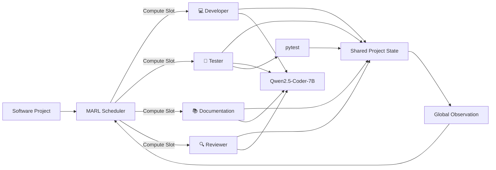
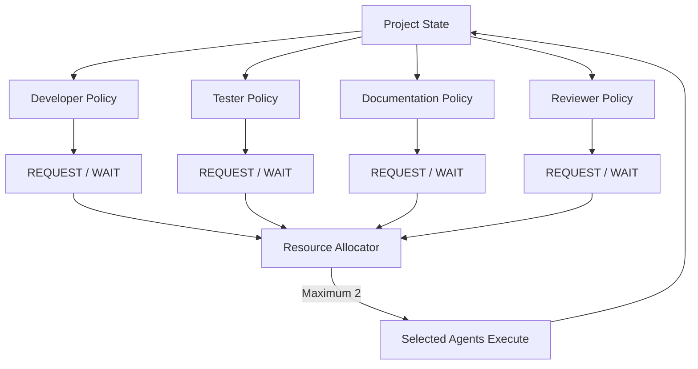
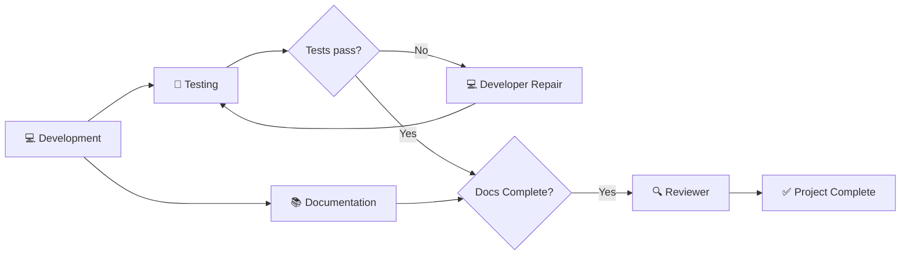
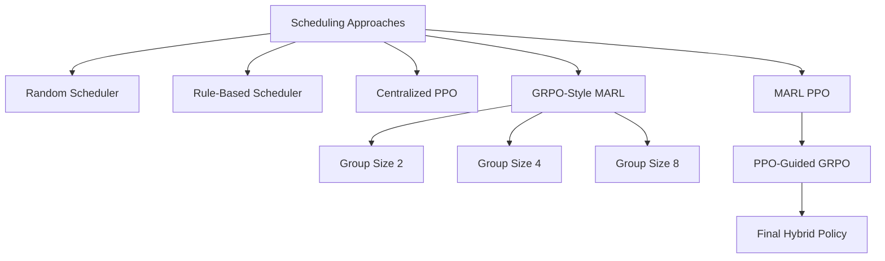
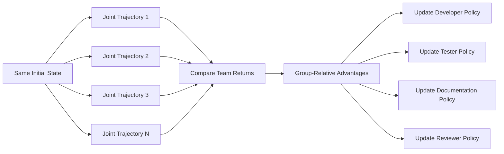
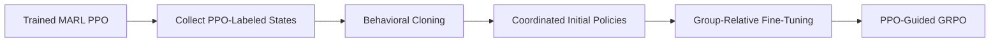
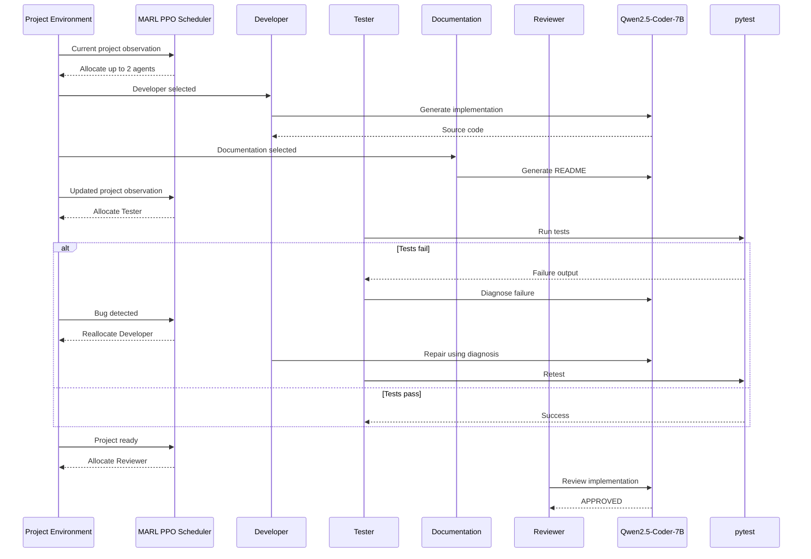
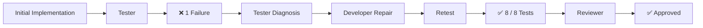

# AgentForge-RL

### Multi-Agent Reinforcement Learning for Coordinating AI Software Development Under Limited Compute

[](https://www.python.org/)
[](https://pytorch.org/)
[](https://docs.ray.io/)
[](#)
[](#)
[](#)

**AgentForge-RL** is a research prototype for coordinating specialized AI software-development agents using **Multi-Agent Reinforcement Learning (MARL)** under limited compute resources.

Instead of allowing every LLM agent to run simultaneously, a learned scheduler determines which agents should receive compute at each step.

The system coordinates four specialized roles:

- 💻 **Developer** — implements features and repairs bugs
- 🧪 **Tester** — executes tests and diagnoses failures
- 📚 **Documentation Agent** — produces project documentation
- 🔍 **Reviewer** — evaluates whether the project is ready for completion

The project compares **rule-based scheduling, centralized PPO, MARL PPO, GRPO-style MARL, and PPO-guided GRPO**, and then transfers the learned MARL policy into a real **Qwen2.5-Coder-7B** software-development workflow.

---

## Research Question

> **Can multi-agent reinforcement learning learn to coordinate specialized AI software-development agents efficiently when compute resources are limited, and can GRPO-style optimization improve that coordination?**

The project focuses on three central problems:

1. **Agent coordination** — deciding which specialist should work at each stage.
2. **Resource allocation** — assigning a limited number of compute slots to competing agents.
3. **Reward design** — balancing individual role objectives with overall project success.

---

# System Overview



The reinforcement-learning policy **does not generate source code itself**.

Instead:

> **RL decides who works.  
> The LLM decides how the assigned work is performed.**

This separation allows reinforcement learning to focus on scheduling and coordination while the language model handles software-development tasks.

---

# Multi-Agent Architecture

Each project is modeled as a shared environment with four agents.



Each agent observes the same global project state but learns its own policy.

The action space for every role is:

```text
0 = WAIT
1 = REQUEST COMPUTE
```

Only a limited number of requests can be granted at each scheduling step.

The primary experiments use:

```text
Agents:     4
Resources:  2
```

---

# Environment State

The RL environment represents project progress with a 10-dimensional observation vector.

| Index | Feature |
|---:|---|
| 0 | Remaining development tasks |
| 1 | Untested work |
| 2 | Known bugs |
| 3 | Documentation progress |
| 4 | Documentation complete |
| 5 | Latest review rejected |
| 6 | Available resource ratio |
| 7 | Development progress |
| 8 | Testing progress |
| 9 | Normalized episode time |

This gives the policies information about both **project progress** and **resource scarcity**.

---

# Learned Workflow

MARL PPO learned a recognizable software-development workflow without being explicitly programmed with a fixed sequence.



A typical learned coordination pattern is:

> **Developer + Documentation → Developer + Tester → Tester → Reviewer**

The exact allocation depends on project state.

---

# Reward Design

A major research question was whether agents should optimize their own role-specific objectives or a shared team objective.

For each agent:

```text
Hybrid Reward =
    α × Individual Reward
    + (1 - α) × Team Reward
```

We evaluated:

| α | Interpretation |
|---:|---|
| 0.00 | Fully shared reward |
| 0.25 | Mostly cooperative |
| 0.50 | Balanced |
| 0.75 | Mostly individual |
| 1.00 | Fully individual |

### Result

Increasing reward individualization progressively harmed coordination.

| α | Success | Steps | Team Reward | Waste |
|---:|---:|---:|---:|---:|
| 0.00 | 1.000 | 9.67 | 45.68 | 0.20 |
| **0.25** | **1.000** | **10.33** | **45.77** | **0.00** |
| 0.50 | 1.000 | 11.60 | 45.28 | 0.00 |
| 0.75 | 1.000 | 13.21 | 45.12 | 0.00 |
| 1.00 | 0.142 | 50.00 | 14.37 | 0.00 |

The fully individual reward setting collapsed to only **14.2% success**.

This demonstrates that strong team-level incentives were important for successful coordination.

---

# Algorithms Evaluated

The project evaluates several scheduling strategies.



---

# Baseline Results

### 500-Episode Evaluation

| Method | Success | Avg. Steps | Team Reward | Waste |
|---|---:|---:|---:|---:|
| Random | 0.998 | 24.07 | -5.78 | 12.64 |
| Rule-Based | 1.000 | 10.79 | 45.94 | 0.00 |
| Centralized PPO | 1.000 | 10.52 | 45.42 | 1.02 |
| **MARL PPO (α=0.25)** | **1.000** | **10.33** | **45.77** | **0.00** |

MARL PPO matched or exceeded the performance of the manually engineered scheduler while learning its coordination strategy through reinforcement learning.

---

# Same-Seed Allocation Comparison

All schedulers were also evaluated on the same project instance to compare their decision sequences directly.

| Algorithm | Success | Steps | Reward | Waste | Review Rejects |
|---|---:|---:|---:|---:|---:|
| Random | ✅ | 24 | -10.30 | 17 | 9 |
| Rule-Based | ✅ | 11 | 44.90 | 0 | 0 |
| Centralized PPO | ✅ | 12 | 52.30 | 1 | 0 |
| **MARL PPO** | ✅ | **11** | 48.90 | **0** | **0** |
| GRPO-Style MARL | ✅ | 21 | 37.80 | 7 | 2 |

On the same instance, MARL PPO matched the hand-engineered scheduler's **11-step completion time with zero wasted allocations and zero premature review attempts**.

---

# Resource Scarcity Experiment

The trained MARL PPO policy was evaluated with different numbers of available compute resources.

| Resources | Success | Steps | Team Reward | Waste |
|---:|---:|---:|---:|---:|
| 1 | 1.000 | 19.04 | 43.40 | 1.58 |
| 2 | 1.000 | 10.33 | 45.77 | 0.00 |
| 3 | 1.000 | 9.35 | 45.51 | 0.00 |
| 4 | 1.000 | 9.35 | 45.18 | 0.64 |

Performance improves dramatically from one to two resources and then begins to saturate.

The result suggests that **more compute does not automatically produce better coordination**.

> Resource levels 1, 3, and 4 are out-of-distribution evaluations because the primary policy was trained using two resources.

---

# GRPO-Style MARL

We implemented a multi-agent adaptation inspired by **Group Relative Policy Optimization**.

This should not be interpreted as standard GRPO inherently being a MARL algorithm.

Our adaptation works by:

1. Sampling multiple joint multi-agent trajectories from the same state.
2. Evaluating each trajectory using the shared project return.
3. Computing group-relative standardized advantages.
4. Updating each role's policy using clipped policy-ratio optimization.
5. Training without a learned value critic.



---

# GRPO Group-Size Ablation

To keep the rollout budget fair, every configuration used **128 trajectories per training iteration**.

| Group Size | Groups | Trajectories |
|---:|---:|---:|
| 2 | 64 | 128 |
| 4 | 32 | 128 |
| 8 | 16 | 128 |

Stochastic evaluation:

| Group Size | Success | Steps | Reward | Waste |
|---:|---:|---:|---:|---:|
| 2 | 1.000 | 15.38 | 38.92 | 8.96 |
| 4 | 1.000 | **15.03** | 38.89 | 7.65 |
| 8 | 1.000 | 15.18 | **39.84** | **6.50** |

Larger comparison groups generally improved reward quality and reduced wasted allocations.

However, from-scratch GRPO remained less efficient than MARL PPO.

---

# Greedy Deployment Failure

An important result was a strong difference between stochastic training-time behavior and greedy deployment.

Some from-scratch GRPO policies achieved:

```text
Stochastic evaluation: 100% success
Greedy evaluation:       0% success
```

The policies had learned useful probability distributions, but their highest-probability joint actions could enter repeated coordination loops.

This revealed an important deployment issue:

> **A successful stochastic MARL policy is not necessarily a reliable deterministic scheduler.**

---

# PPO-Guided GRPO

The strongest GRPO experiment initialized the GRPO policies using behavior cloned from the successful MARL PPO coordinator.



This dramatically improved GRPO performance.

### Final Learned-Policy Comparison

| Method | Success | Steps | Team Reward | Waste | Review Rejects |
|---|---:|---:|---:|---:|---:|
| **MARL PPO** | 1.000 | 10.33 | **45.77** | **0.00** | **0.00** |
| **PPO-Guided GRPO** | 1.000 | **9.88** | 43.18 | 0.20 | 0.52 |
| GRPO-Style MARL G8 | 1.000 | 15.18 | 39.84 | 6.50 | 0.45 |

### Main Finding

**MARL PPO achieved the best overall balance of reward, efficiency, resource discipline, and reviewer behavior.**

**PPO-Guided GRPO achieved the fastest average completion time.**

Therefore:

> **GRPO-style optimization was considerably more effective as a fine-tuning mechanism for an already coordinated policy than as a from-scratch MARL optimizer under limited compute.**

---

# Real LLM Deployment

After RL training, the MARL PPO scheduler was connected to a real local language model:

```text
Qwen/Qwen2.5-Coder-7B-Instruct
4-bit NF4 quantization
```

The scheduler receives the current project observation and determines which roles receive the two available compute slots.

The selected roles then execute real LLM calls.



---

# Live Projects

The real 7B deployment was validated on four software projects.

| Project | Result |
|---|---|
| Bank Account | ✅ 12 / 12 tests |
| Todo List | ✅ 8 / 8 tests |
| Inventory Manager | ✅ 11 / 11 tests |
| Password Validator | ✅ Repair loop → 8 / 8 tests |

The **Password Validator** is the most important recovery example.



This demonstrates a real closed-loop software-development process rather than a pre-recorded success path.

---

# Interactive Dashboard

The project includes a Streamlit research dashboard.

Features include:

- 🔴 Live AI team execution
- 🎛 Resource-allocation replay
- 📊 Algorithm comparisons
- 🧠 Research summary
- Live PPO observations
- Resource-slot visualization
- Agent request/allocation states
- Generated code display
- Real pytest output
- Tester diagnosis
- Reviewer decision
- Activity timeline

Run it with:

```bash
streamlit run ui/dashboard.py \
  --server.address 0.0.0.0 \
  --server.port 8501
```

---

# Repository Structure

```text
AgentForge-RL/
│
├── agents/
│   ├── developer.py
│   ├── tester.py
│   ├── documentation.py
│   └── reviewer.py
│
├── environment/
│   ├── marl_env.py
│   └── multi_agent_env.py
│
├── evaluation/
│   └── ...
│
├── integration/
│   ├── live_multi_project_runner.py
│   ├── rl_scheduler.py
│   ├── rl_team_runner.py
│   └── rl_bank_runner.py
│
├── llm/
│   └── model_7b.py
│
├── planner/
│   └── planner.py
│
├── schedulers/
│   ├── random_scheduler.py
│   └── rule_based_scheduler.py
│
├── training/
│   ├── train_ppo.py
│   ├── train_marl_ppo.py
│   ├── train_marl_grpo.py
│   ├── train_marl_grpo_role_aware.py
│   ├── train_ppo_guided_grpo.py
│   └── train_ppo_guided_grpo_v2.py
│
├── ui/
│   └── dashboard.py
│
├── results/
│   ├── allocation_summary.csv
│   ├── allocation_traces.csv
│   ├── ppo_guided_grpo_results.csv
│   └── checkpoints/
│
├── tests/
│
├── demo.sh
├── requirements.txt
├── requirements-demo.txt
└── README.md
```

---

# Installation

## 1. Clone the repository

```bash
git clone https://github.com/Gopal-Singh-Subramani-Singh/AgentForge-RL.git
cd AgentForge-RL
```

## 2. Create an environment

Example using `venv`:

```bash
python -m venv .venv
source .venv/bin/activate
```

## 3. Install dependencies

For the RL experiments:

```bash
pip install -r requirements.txt
```

For the real LLM demo:

```bash
pip install -r requirements-demo.txt
```

---

# GPU Requirements

The real LLM demo was developed using:

```text
NVIDIA A100 MIG
~9.5 GB available GPU memory
```

The quantized Qwen2.5-Coder-7B model used approximately:

```text
Allocated: ~5.18 GB
Reserved:  ~5.33 GB
Free:      ~4.04 GB
```

RL-only environment experiments can be executed without loading the 7B language model.

---

# Running the Live Demo

A convenience script is provided:

```bash
./demo.sh
```

Individual projects can also be executed directly.

### Bank Account

```bash
python -m integration.live_multi_project_runner \
  --project bank
```

### Todo List

```bash
python -m integration.live_multi_project_runner \
  --project todo
```

### Inventory Manager

```bash
python -m integration.live_multi_project_runner \
  --project inventory
```

### Password Validator

```bash
python -m integration.live_multi_project_runner \
  --project password
```

For the most interesting demonstration, use:

```bash
python -m integration.live_multi_project_runner \
  --project password
```

because this project exercises the complete:

```text
failure
→ diagnosis
→ repair
→ retest
→ approval
```

pipeline.

---

# Reproducing Core Experiments

## Centralized PPO

```bash
python training/train_ppo.py
```

## MARL PPO

```bash
python training/train_marl_ppo.py
```

## GRPO-Style MARL

```bash
python training/train_marl_grpo.py
```

## Role-Aware GRPO

```bash
python training/train_marl_grpo_role_aware.py
```

## PPO-Guided GRPO

```bash
python training/train_ppo_guided_grpo.py
```

---

# Key Findings

### 1. Cooperative rewards are essential

Fully individual rewards caused coordination to collapse.

### 2. MARL PPO learned strong resource allocation

The learned policy achieved:

```text
100% success
~10.33 average steps
0 wasted allocations
```

### 3. More compute has diminishing returns

Increasing resources from one to two substantially improved completion speed.

Increasing resources beyond three produced little additional improvement.

### 4. From-scratch GRPO was less efficient

GRPO-style MARL successfully learned coordination but required more steps and produced more wasted allocations than MARL PPO.

### 5. Stochastic and greedy deployment can behave very differently

Some GRPO policies succeeded under stochastic sampling but failed when converted directly to greedy argmax actions.

### 6. PPO-guided GRPO was much stronger

Initializing GRPO from an already coordinated MARL PPO policy:

- removed the severe greedy-deployment failure,
- dramatically reduced wasted allocations,
- and produced the fastest learned coordinator.

### 7. Learned scheduling transferred to real LLM agents

The trained MARL PPO scheduler successfully coordinated real 7B software-development agents across multiple projects.

---

# Limitations

This project is a research prototype.

Important limitations include:

- The synthetic RL environment abstracts many details of real software engineering.
- The real deployment uses relatively small benchmark projects.
- The primary MARL policy was trained with two compute resources.
- Resource evaluations at 1, 3, and 4 resources therefore test out-of-distribution generalization.
- GRPO experiments used a limited training budget.
- All MARL agents currently observe the same global project state.
- The real LLM workflow uses a single local model to instantiate multiple specialized roles.
- The system does not yet optimize wall-clock GPU cost directly.
- Long-running production software projects would require richer state representations and task graphs.

---

# Future Work

Possible extensions include:

- Larger and more diverse software projects
- Dynamic task graphs
- Heterogeneous LLMs for different roles
- Explicit GPU-memory and latency costs
- Decentralized observations
- Recurrent policies
- Hierarchical RL
- Learned task decomposition
- Larger GRPO groups
- Curriculum learning
- Human-in-the-loop code review
- Multi-repository development tasks
- Long-horizon issue resolution
- Comparison with LLM-based planning schedulers

---

# Research Conclusion

AgentForge-RL demonstrates that **multi-agent reinforcement learning can learn meaningful coordination strategies for AI software-development teams operating under constrained compute resources**.

MARL PPO achieved the strongest overall balance of:

- project success,
- completion efficiency,
- resource utilization,
- reward,
- and reviewer discipline.

From-scratch GRPO-style MARL was substantially less efficient.

However, when GRPO-style optimization was initialized from an already coordinated PPO policy, it produced the **fastest learned scheduler**.

The final result suggests a useful division of labor between the algorithms:

> **PPO is effective for learning stable multi-agent coordination from scratch, while group-relative optimization is more promising as a fine-tuning mechanism for already coordinated policies.**

Finally, deploying the trained scheduler with a real Qwen2.5-Coder-7B model demonstrated that the learned coordination strategy could transfer beyond the synthetic environment into an actual software-development loop involving implementation, testing, failure diagnosis, repair, documentation, and review.

---

# Project Status

✅ RL environment complete  
✅ Random and rule-based baselines  
✅ Centralized PPO  
✅ MARL PPO  
✅ Reward-design ablation  
✅ Resource-scarcity evaluation  
✅ GRPO-style MARL  
✅ GRPO group-size ablation  
✅ Greedy vs. stochastic analysis  
✅ Role-aware GRPO  
✅ PPO-guided GRPO  
✅ Real Qwen2.5-Coder-7B deployment  
✅ Four live software projects  
✅ Streamlit research dashboard  
✅ Final project frozen

Final frozen release:

```text
Git tag: final-project-complete
```

---

# Author

**Gopal Singh Subramani Singh**

San Diego State University  
CS 654 — Reinforcement Learning  
Fall 2026

---

## Repository

**AgentForge-RL**

https://github.com/Gopal-Singh-Subramani-Singh/AgentForge-RL
